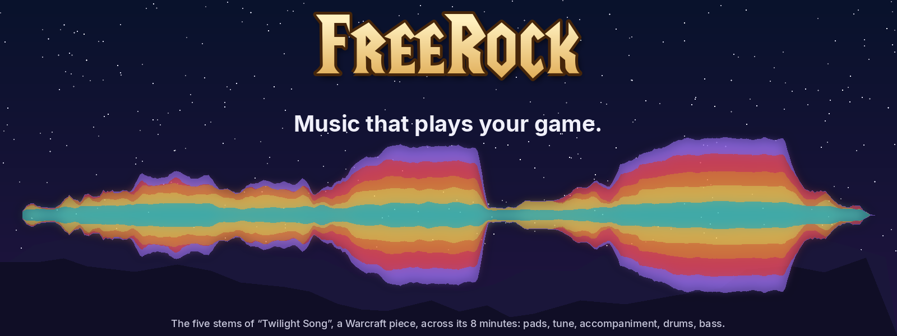
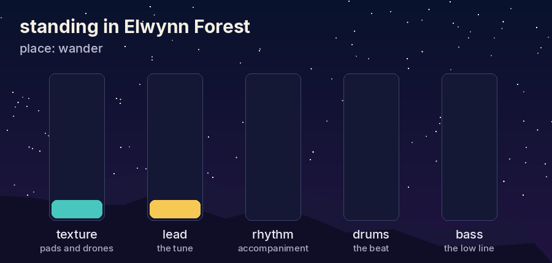
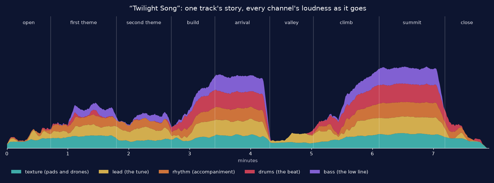
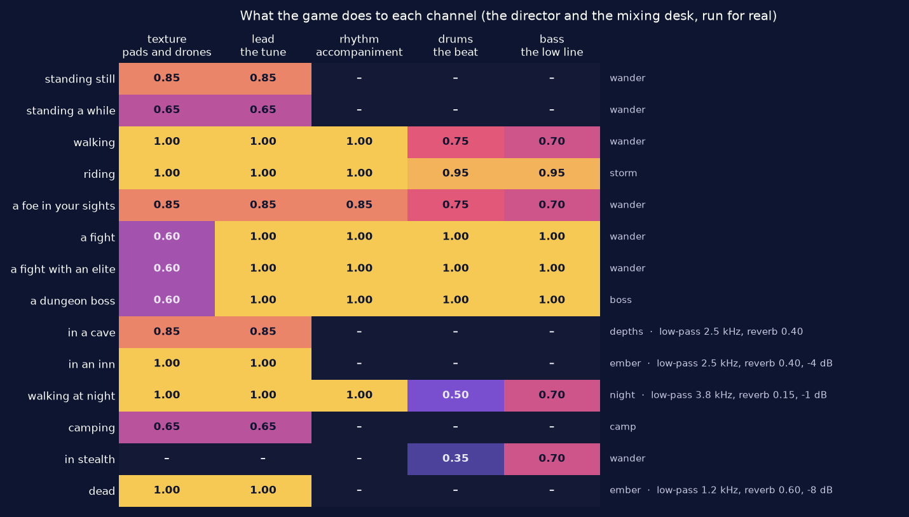
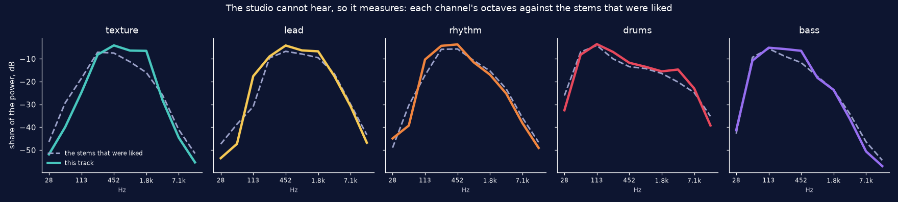
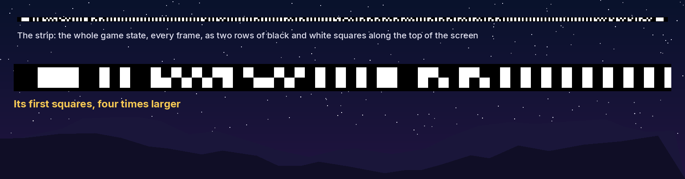
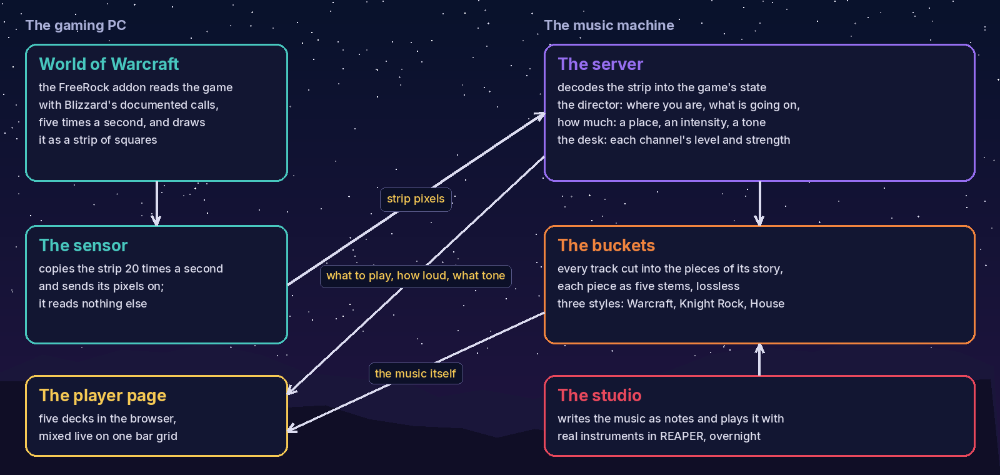
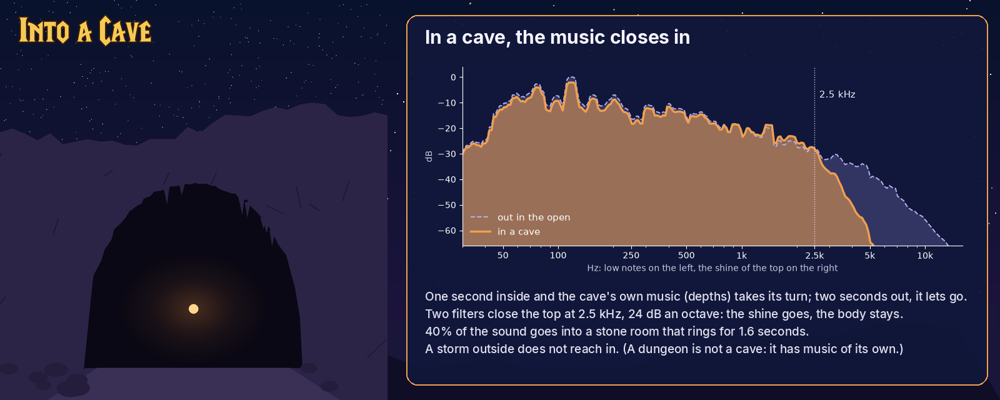
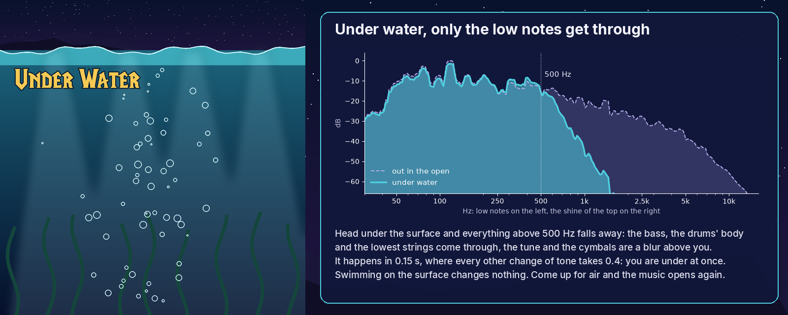
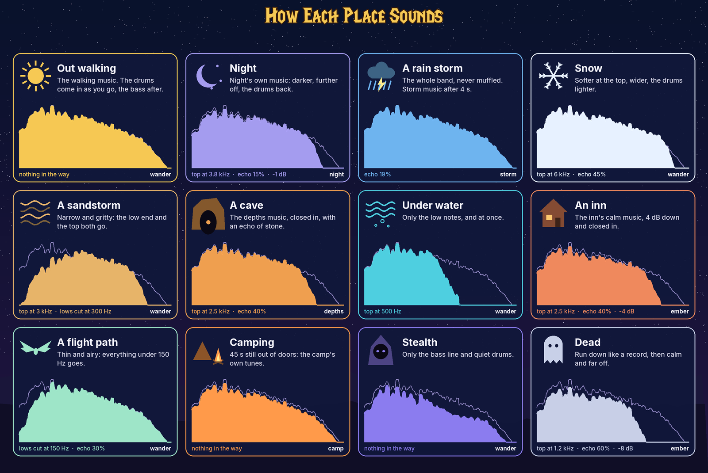

<p align="center">
  
</p>

<h1 align="center">FreeRock</h1>

<p align="center">
  <b>A soundtrack for World of Warcraft: Forever that plays your game.</b><br>
  Original music, written, performed and mixed by its own studio, then conducted live by what you do:<br>
  walk, ride, fight, hide, camp, die.
</p>

<p align="center">
  
  
  
  
  
  
  <a href="LICENSE"></a>
</p>

<p align="center">
  <a href="#listen">Listen</a> ·
  <a href="#get-started">Get started</a> ·
  <a href="#how-it-works">How it works</a> ·
  <a href="#the-music">The music</a> ·
  <a href="#the-studio">The studio</a> ·
  <a href="#commands">Commands</a> ·
  <a href="#staying-within-the-rules">The rules</a> ·
  <a href="#developing">Developing</a>
</p>

---

Game music has always had to guess. A zone gets a few tracks, a fight gets a sting, and the same
three minutes come round again whatever you are doing.

**FreeRock doesn't guess. It watches.** An addon reports what the game is doing five times a
second. A director turns that into a target: what kind of moment it is, how much is going on, and
what the music should sound like. A player in the browser takes the target and moves five
channels of a written track to meet it. Start walking and the drums come in. Stand still and the
music settles. Put a wolf in your sights and the bass leans in. A dungeon boss gets music of its
own, and afterwards the track you were in carries on where it left off. Wait out of doors long
enough and you are camping, which has its own tunes.

**It isn't loops or stock music either.** Every track is original: written as notes by
FreeRock's own studio, played on recorded instruments (a Muse Sounds orchestra, sampled drums
and guitars, Surge XT synths), mixed in REAPER through real plug-ins, measured octave by octave
against stems that were liked by ear, and kept lossless. The studio writes more every night.

<p align="center">
  
</p>

## Listen

A minute or less of each style, as the studio rendered it (the whole mix, every channel up):

| | | |
|---|---|---|
| **Warcraft** | [Twilight Song](docs/samples/twilight-song.mp3) | the build into its first arrival: harp, strings, horns and a wordless choir |
| **Knight Rock** | [Lightning Runner](docs/samples/lightning-runner.mp3) | a storm piece climbing into its moment: riff guitars, a twin lead, the Hammond and the kit |
| **House** | [The King's Road](docs/samples/the-kings-road.mp3) | the breakdown, the build and the drop |
| **Warcraft, camping** | [Watchfire Wait](docs/samples/watchfire-wait.mp3) | what plays while you wait out of doors: a classical guitar, English horn and flute over hushed strings |

In the game you never hear a track quite like this: the five channels move with what you do.

## What you get

<table>
  <tr>
    <td width="50%" valign="top">
      
      <b>Tracks that tell a story.</b> A Warcraft or Knight Rock track runs about eight minutes in
      nine sections: an opening, two themes, a build, an arrival, a valley, a climb, a summit and a
      close (House builds and drops in eight). The quiet stretches breathe, the big ones land, and
      the song never stops to loop.
    </td>
    <td width="50%" valign="top">
      
      <b>Every channel follows the game.</b> Pads, tune, accompaniment, beat and low line are
      five separate recordings, and each has its own fader. A fight brings them all up, stealth
      drops to the bass line, and a cave closes the sound in.
    </td>
  </tr>
  <tr>
    <td width="50%" valign="top">
      
      <b>Measured, not guessed.</b> The studio's "ear" measures each channel's balance across
      ten octaves and compares it with stems that were liked by ear. Bass that is too heavy, a
      lead with nothing under it, a kit that is too dull: each shows up as a number.
    </td>
    <td width="50%" valign="top">
      
      <b>The whole game state in a strip of squares.</b> A strip a few pixels tall along the top
      of the screen, with a sync pattern and a checksum, readable through gamma, HDR, colour
      filters and the dimming you see when you die. The addon uses only documented calls.
    </td>
  </tr>
</table>

## Get started

FreeRock needs two machines you probably already have: a **Linux machine** that makes and plays
the music, and the **Windows PC** you play on. The music is not downloaded: your own studio makes
it, so the first run includes setting the studio up. After that, it is four commands and a game.

**1. Get FreeRock** on the Linux machine (you need [uv](https://docs.astral.sh/uv/)):

```
git clone https://github.com/skytruax/FreeRock.git
cd FreeRock/app
uv sync
```

**2. Set up the studio, once.** It plays real instruments, so it needs them: REAPER, MuseScore
Studio with its free Muse Sounds, a few free plug-ins and some sample libraries.
[tools/stems/README.md](tools/stems/README.md) lists every one, where to get it and its licence.
Then let the studio meet its instruments. It plays each one alone in REAPER and measures it:

```
uv run --no-sync python -m freerock.studio.sounds
```

**3. Make your first music.** Pick a few tracks from the list, render them, and put them in a
bucket:

```
uv run --no-sync python -m freerock.studio.build --list             # every track the orchestra and the band can write
uv run --no-sync python ../tools/render_some.py --workers 3 pastoral-village-dance-1/1 haunted-requiem-1/1 highland-snowfall-1/1
uv run freerock pieces add warcraft --zone "Elwynn Forest"
```

Each track is several minutes of music and takes a few minutes to render. Leave a long list
rendering overnight and you wake up to hours of it. [docs/songwriting.md](docs/songwriting.md)
covers the rest: Knight Rock and House, and writing tracks of your own.

**4. Play.** Start the server on the Linux machine:

```
uv run freerock serve
```

Open `http://localhost:8765/player` to hear it right away. The page has a **pretend game** panel
(pick a zone, tick cave, fight, night or weather) that moves the music exactly as the game would.

Then, on the gaming PC:

1. Install uv once, in PowerShell:
   `powershell -ExecutionPolicy ByPass -c "irm https://astral.sh/uv/install.ps1 | iex"`
2. Put the addon in the game and start reading the screen:
   `uv run http://<music machine>:8765/sensor.py --install-addon`
   It shows the AddOns folder it found and asks before copying anything.
3. Start the game and type `/rock test`. `http://<music machine>:8765/` shows what FreeRock sees,
   and `http://<music machine>:8765/player` plays it.

From then on, `http://<music machine>:8765/FreeRock.cmd` downloads a launcher that does it all in
one click: it opens the player in its own window, with sound allowed to start by itself, and
starts the sensor.

To hear one song for certain, name it in the player's address:
`http://<music machine>:8765/player?cue=knight/pastoral-free-company-1/5&at=climb`. When the music
begins, that track plays from there (`at` is `climb`, `summit`, a piece's place, or left out for
its opening), every part from that take, and on to its end; then the player chooses as it always
does. It works once for each time the page is opened.

## How it works

<p align="center">
  
</p>

1. **The addon** (`FreeRock/`, Lua) reads the game every 0.2 s through Blizzard's documented
   API: where you are, whether you are moving, indoors, resting, mounted, on a flight path, in
   stealth, under water, dead, in combat, what you have targeted, how many foes are in view,
   boss encounters, the weather and whether it is day. Moments arrive as they happen: a level
   gained, a quest handed in, a boss beaten.
2. **The strip** (`Beacon.lua`, format in [protocol/beacon.md](protocol/beacon.md)) packs all of
   it into a few dozen bytes with a version and a checksum, and draws them as black and white
   squares on the next frame.
3. **The sensor** (`app/freerock/web/sensor.py`) copies the strip's pixels 20 times a second
   while the game is the window in front, and sends them on. It decodes nothing, so it has
   nothing to get wrong. It is a single file served by the server, so the gaming PC always
   runs the current version.
4. **The server** (`app/freerock/`, Python) decodes the strip. If frames stop coming, it holds
   the last good state. The **director** (`director.py`) turns the state into a target: a
   *place* (what kind of music), an *intensity* (how much is going on), levels for the bed,
   drums and bass, and a tone (filters, reverb, volume). The **mixing desk** (`forever.mix`)
   gives each of the five channels its level.
5. **The player** (`app/freerock/web/player/`, in the browser) plays a piece's five recordings
   together, scheduled ahead on the audio clock and locked to the sample, each at the level the
   game asks for, and moves them like a hand on a fader: up over about 4 s, down over about 6.

A fight is heard starting to come up about a quarter of a second after it begins, and is fully
up after about four. Everything from the game to the speakers is written down, knob by knob, in
[docs/signals-and-channels.md](docs/signals-and-channels.md).

## The music

### Three styles

| Style | What it is | Played by |
|---|---|---|
| **Warcraft** | An orchestral score in the old manner: strings and horns, choir, harp, war drums | Muse Sounds' strings, brass, woodwinds, choir, harp and percussion in MuseScore; war drums, timpani and hand percussion from recorded kits and sample libraries |
| **Knight Rock** | A riff-driven rock band. The riff carries the walking music, and the whole band comes in for the fights | Muse Sounds' electric guitars, bass and Hammond organ; a 1970s rock kit with a 26-inch bass drum |
| **Progressive House** | Builds, drops and long breakdowns, with the pads ducking under every kick | Surge XT's synths; Muse Sounds' piano, electric pianos, marimba, harp, flute, strings and brass; a TR-8 drum machine |

As of the morning of 2026-11-17 the buckets hold **90 tracks, over 11 hours**: 50 Warcraft (6.6
hours), 20 Knight Rock (2.6) and 20 House (2.0). More are rendered every night.

### A track is a story

Each track is cut at its sections into **pieces**, and each piece keeps its five channels as
separate recordings in step with each other:

| Channel | What it is | Warcraft | Knight Rock | House |
|---|---|---|---|---|
| texture | the bed: pads, drones, held chords | strings, organ, choir | Hammond, pads | Surge pads, the air |
| lead | the tune | the solo instruments | lead and clean guitar | lead synths, Muse keys and winds |
| rhythm | the accompaniment: figures, riffs, arpeggios | harp, plucked strings, ostinati | the riff guitars | plucks, stabs, keys |
| drums | the beat | war drums, timpani, percussion | the rock kit | the TR-8 kit |
| bass | the low line | cellos and basses, contrabassoon | electric bass | sub, growl, bass synths |

Pieces run straight into each other and the track tells its story. Light and heavy tracks take
turns, so a long stay in one place doesn't keep getting more intense. Takes of the same family
share a form and a key, so each channel's part can come from a different take: the same story,
told by another band each time.

### Where you are, and what is going on

A track says what it is for. There are **eleven kinds of place**: pastoral, highland, haunted,
desert, jungle, infernal, regal, mystic, marsh, coast and frozen. Every zone and named subzone belongs to one or two of
them, read from its profile (`app/freerock/kinds.py`, `atlas/`). There are also **kinds of
moment**, and the director picks one, first match wins:

| In the game | The music |
|---|---|
| a dungeon boss | **boss**: its own music, heavy. The track you were in waits for you |
| a battleground or arena | **battleground**: its own family, through every fight and every death |
| a cave or a building | **depths**, within a second of going in, and closed in: low-passed and echoing |
| an inn | **ember**: calm, and quieter |
| a town's streets | **town**: the town's own family |
| a rain storm that has set in | **storm**: the whole band, never muffled |
| a long ride, or fights close together | **full tilt**: the hard-rock part |
| still for 45 s out of doors | **camp**: waiting on a spawn, a rare or a friend, with tunes of its own |
| night, out of doors | **night**: darker, further off, the drums well back |
| anything else | **wander**: the walking music |

### What a place does to the sound

A place changes more than which track plays: it changes how the music sounds. The player has its
own tone controls after the five decks: two low-pass filters one after the other (24 dB an
octave), a high-pass, an echo (a stone room that rings for 1.6 s) and a volume. The director sets
them for every place, and they move over 0.4 s.

<p align="center">
  
</p>

**A cave** closes the music in. The moment you step inside, the top of the sound closes at 2.5 kHz
and 40% of it goes into the stone room; within a second the cave's own music (the depths family)
takes its turn. Step out and the sound opens at once, and the cave's music lets go two seconds
later. A dungeon is not treated as a cave: it is indoors from end
to end, so it gets its own tension and its own pieces, not the muffle.

<p align="center">
  
</p>

**Water** is about your head, not your feet. Swimming on the surface changes nothing. Go under and
everything above 500 Hz falls away: the bass, the drums' body and the low strings come through,
and the tune and the cymbals blur above you. It happens in 0.15 s instead of 0.4, so you are under
at once, and coming up for air opens the music again just as fast.

<p align="center">
  
</p>

Each card puts the same real track through the player's own filters, at the levels the player
would set there, using the director's numbers for that place. The faint line is the open air.

The place sets which track. **What you do** sets how much of it you hear. One number, the
intensity, climbs a ladder:

| You are | Intensity | The band |
|---|---|---|
| standing a while | 0.10 | every channel about 4 dB down |
| standing | 0.25 | every channel about 1.5 dB down |
| walking | 0.40, building over 20 s | the drums come up, then the bass |
| riding | 0.60, building over 25 s | drums and bass up at once; a long ride goes full tilt |
| a foe in your sights | 0.57; 0.68 for an elite or a rare | leaning in |
| in a fight | 0.80 and climbing; up to 0.96 with more foes; 0.92 for an elite or a rare | the whole band at full |
| a dungeon boss, a world boss | 1.0 | the boss's own music, at full |

Each written piece keeps a floor under its drums and bass, so going from calm to a fight is a
lift, not a switch being thrown. That was asked for after the first evening of play.

Moments get the whole band for a few seconds: a level gained, a boss beaten, an achievement, a
quest handed in. Fights close together keep the band up between them. Stealth drops everything
but the bass line and quiet drums. Under water the sound closes to 500 Hz. A death runs the music
down like a record stopping, and the ghost walks back to calm, far-off music. In a battleground
the music plays on through a death. Every few minutes
the music comes down to a short silence, as the game's own music does, and a fight brings it
straight back.

## The studio

The studio (`app/freerock/studio/`) makes the music, from the first note to the lossless file in
the bucket.

**1. Write.** The writers compose in Python, as notes with dynamics, articulations and a form.
`orchestra.py` (run by `build.py`) writes Warcraft and Knight Rock: themes, counter-melodies,
ostinati and riffs, voiced for the instruments that will play them, with levels drawn through
each section. `house.py` writes the House tracks: grooves, chords, plucks, risers and drops.

**2. Play.** Every part is performed by recorded instruments. The orchestra is MuseScore Studio
with Muse Sounds: 117 recorded instruments covering strings, brass, woodwinds, choir, harp,
keys, guitars and percussion. Sample libraries fill in what MuseScore does not play, through
sfizz inside REAPER: VCSL's mallets, bells and world percussion, Karoryfer's very large drums and
Naked Drums for a kick (VSCO-2 CE and TinySOL stand in where MuseScore is missing). The war drums
and the rock kits are the AVL drum kits. House's synths are Surge XT patches, each at
the octave it was measured to need, and its drums are a TR-8's own recordings.

**3. Mix.** `desk.py` builds a REAPER project for each track and renders every channel on its
own. Each source gets its own equaliser, and there is compression, a hall and a room from
Dragonfly Reverb, parallel compression on the drums, and a limiter at the end of every channel.
House's desk (`club.py`) also rides each synth voice's level in four-bar spans from its loudest
notes, puts a sine sub under the plucked and sawtooth basses on their own notes, and lets the
bass, the pads, the chords and the tune give way under every kick.

**4. Measure.** The studio has no ears, so it measures. `ear.py` takes each channel's balance in
ten octaves from 20 Hz to 20 kHz and sets it against the stems that were liked. House tracks are
also checked as they render: the moment has to be the loudest part, nothing may clip, the chords
and the tune have to be in tune and in the key, and the drums on time.

**5. Keep.** A finished track is written as a 24-bit FLAC stem for each channel that plays, with
its sections, its kinds of place and moment, its key and its tempo (`track.json`). `freerock
pieces add` cuts new tracks into pieces and puts them in its style's bucket as 16-bit FLAC
(`tools/fresh_bucket.py` rebuilds a bucket from everything staged, takes made again included). What
has been played, loved and banned is kept apart from the buckets, in `var/plays.sqlite3`, part by
part by where each sits in its track: a bucket built again takes it all back, so the player does not
take heard music for new (`freerock/playbook.py`). `tools/listen.py` makes a listening
page for every track: the whole mix to play, and a mixer with a fader for each channel.

**6. Overnight.** Rendering is heavy (REAPER, MuseScore and the sampler for every channel of
every section), so tracks are queued in lists and rendered in lanes: a quarter of the machine
by day, all of it at night, and half while the game is being played. Buckets are rebuilt only
while the game is off.

## Commands

**In the game:**

| Command | What it does |
|---|---|
| `/rock` | Opens the settings |
| `/rock on`, `/rock off` | Turns FreeRock on or off. Off puts the game's own music back |
| `/rock skip`, `/rock love`, `/rock ban` | Play something else; mark what is playing as loved; never play it again |
| `/rock volume <0-100>` | How loud FreeRock plays |
| `/rock gamemusic on`, `off` | Leave the game's own music on as well, or off while FreeRock is on |
| `/rock strip top`, `bottom`, `size <1-8>`, `faint`, `bright`, `ink <10-100>`, `inset <left> [edge]` | Where the strip is, how big its squares are and how bright |
| `/rock test` | Sends a test pattern for ten seconds |
| `/rock status` | What the addon sees, the weather values the game reports, and any errors |

**The program and the studio** (from `app/`):

| Command | What it does |
|---|---|
| `freerock serve` | Runs FreeRock |
| `freerock pieces list [style]` | What a style's bucket holds: tracks, minutes, and how they divide by moment, place, light and heavy |
| `freerock pieces add [style]` | Puts every track the studio has staged into its style's bucket. Stop the server first |
| `freerock pieces drop <style> <source>` | Takes every piece whose source begins with `<source>` out of the bucket. Stop the server first |
| `freerock settings [name value]` | `rest_every_minutes` and `rest_seconds` (the silences), and `genre` (warcraft, knight or house) |
| `freerock sim <scenario>` | Plays a scripted session against a running server, drawing and reading the real strip |
| `freerock read <picture>` | Reads the strip out of a saved screenshot |
| `uv run --no-sync python -m freerock.studio.build` | Writes and plays the orchestra's and the band's tracks (`--list` shows what there would be, `--style knight` the band only) |
| `uv run --no-sync --with numba python -m freerock.studio.club <family/take> ...` | Writes and plays House tracks (`--list` shows the House plan) |
| `uv run --no-sync python ../tools/render_some.py <family/take> ...` | Writes and plays a chosen list of tracks, several at a time |
| `uv run --no-sync python ../tools/fresh_bucket.py <style>` | Rebuilds a style's bucket from everything staged now. Stop the server first |
| `uv run --no-sync python ../tools/listen.py [style]` | A listening page and a mixer for every staged track, at `/listen/` |
| `uv run --no-sync python ../tools/soak.py [style]` | A pretend evening played through the running server and a hidden browser, to see what was chosen and whether it played cleanly |

## Staying within the rules

- The addon calls only functions Blizzard documents and reads only values the game never seals.
  Health, threat and the identity of units outside the group are sealed in combat. They are not
  read, not sent, and not worked out some other way.
- In the game it does two things: it draws the strip, and it switches the game's own music off
  (and back on at logout or `/rock off`).
- The program outside the game only looks at a patch of the screen, and only while the game is
  the window in front. It never reads the game's memory, never sends keys or clicks, and never
  changes game files.
- Blizzard's licence has a broad clause against unauthorised software that "reads information
  generated by the Platform", and Blizzard has not said whether passive screen readers are fine.
  The strip was chosen knowing that.

## Developing

```
cd app && uv run --no-sync --with numba pytest -q      # the Python, and the player in headless Chrome (muted)
cd app && uv run python ../tools/tests/run.py          # the addon's Lua, against a stand-in for the game client
tools/sim/run.sh                                       # the addon beside Blizzard's real interface code (Docker)
```

The player is tested by rendering it offline in headless Chrome: a piece's five channels stay
aligned to the sample, a song plays whole and changes only where the rules say, a fight's rise
comes in on the next bar line, and the output never clips. The director is
tested against scripted sessions, and the strip by a round trip: the real `Beacon.lua` draws it,
the picture is distorted (gamma, contrast, tint, dimming, blur), and the real decoder has to read
it back.

```
FreeRock/          the addon (goes into _forever_\Interface\AddOns\)
protocol/          the strip's format and its test vectors
app/freerock/      the program: the game link (beacon, state, server, web/sensor.py), places
                   (atlas, kinds), what plays (director, conductor, forever, web/player), and
                   the commands (cli, musiccli)
app/freerock/studio/   the studio: writers (orchestra, build, house), players (muse,
                   sounds, sfz, reaper, club), the desk, the ear
app/tests/         the Python tests
tools/             the listening pages, render tools, the Lua tests, the simulator, these pictures
docs/              how signals become music, the places, the plans
var/               everything made at run time: buckets, staged tracks, logs (not in git)
```

| Read more | |
|---|---|
| [docs/songwriting.md](docs/songwriting.md) | The songwriting handbook: the brief, how each style is written, played, mixed and checked, and how to make more |
| [docs/signals-and-channels.md](docs/signals-and-channels.md) | Every signal, rule and knob from the game to the five channels, and what is still to be argued over |
| [docs/places.md](docs/places.md) | Every kind of place and moment, and how many tracks each style has for it |
| [protocol/beacon.md](protocol/beacon.md) | The strip, square by square |
| [tools/stems/README.md](tools/stems/README.md) | Every instrument and plug-in the studio plays, where it came from, and its licence |
| [CHANGELOG.md](CHANGELOG.md) | What the evenings in the game changed |

The pictures in this file are drawn from the real code and a real track by
`tools/readme_pictures.py`.

## Credits and licences

FreeRock's code and documents are under the [MIT licence](LICENSE). The music is not in the
repository, apart from the four short samples above: every studio writes and plays its own. It is
played on instruments that others recorded and gave away: MuseScore Studio and Muse Sounds (Muse
Group; music made with them is its maker's, and the sounds themselves are never shared here);
VSCO-2 CE, VCSL and Karoryfer's instruments (CC0); the AVL drum kits by Glen MacArthur (CC BY-SA
3.0); Naked Drums by Wilkinson Audio (CC BY 4.0); TinySOL by Cella, Ghisi, Lostanlen, Lévy,
Fineberg and Maresz at IRCAM (CC BY 4.0); the TR-8 recordings from MckAudio (CC0); Surge XT,
sfizz, Dragonfly Reverb, x42, Calf and the other free plug-ins in REAPER. Each one, and its
licence, is listed in [tools/stems/README.md](tools/stems/README.md).
